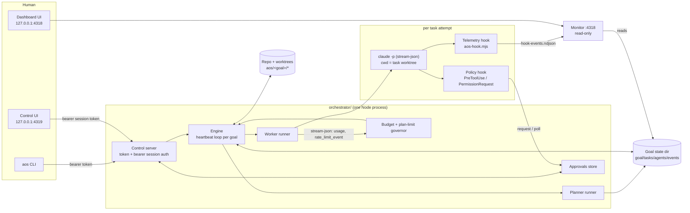
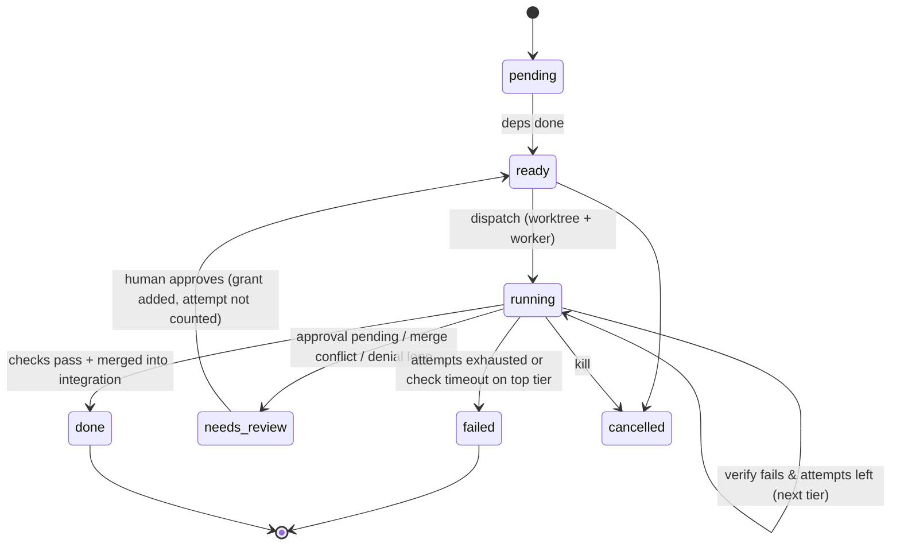

# AOS Orchestrator: design

Status: proposal · Evidence: [orchestrator/spike](../orchestrator/spike/README.md) (Claude Code 2.1.303, macOS, subscription auth).
Spike verdicts are cited as **[S-n]**, the row numbers of the spike results table.

## 1. Goals, non-goals, principles

**Goals.** Turn one human-written Goal into merged-ready work on a branch: plan once with Opus, run headless Claude Code
workers in isolated git worktrees on the cheapest model tier that passes, verify every task with real commands, and
integrate the results onto `aos/<goal>/integration`. Implement AOS-1 ([SPEC.md](https://github.com/tomtomsatnav/aos-1-spec/blob/v1.0.0/SPEC.md) §3–§7) with real dispatch.

**Non-goals.** No LLM in the control loop. No auto-merge to `main`, no push, no deploys. No remote hosts, no multi-user
server, no Windows support in v1. No replacement for interactive Claude Code: the orchestrator runs well-specified work.

**Principles.**
1. *Deterministic engine, stochastic leaves.* Only the planner and workers call a model. Every state change is code + an Event.
2. *Policy is enforced outside the model.* A hook that the model cannot see or argue with decides every tool call.
3. *Fail closed.* Unknown command, hook timeout, unparseable output, lost worker: deny, stop, or mark failed, never guess.
4. *The user's plan quota is shared.* The orchestrator yields before the user hits a limit, not after.
5. *Zero dependencies, plain files, localhost only.* Same constraints as the rest of the repo (Node 18+).
6. *The monitor stays read-only.* Control lives in a separate process with its own auth.

## 2. Architecture and data flow



| Component | File (proposed) | Responsibility |
|---|---|---|
| Engine | `orchestrator/engine.mjs` | AOS-1 tick per goal (§4); owns all state writes |
| Planner | `orchestrator/planner.mjs` | One Opus call → task DAG JSON → validation → plan approval |
| Worker runner | `orchestrator/worker.mjs` | Worktree, env, command line, stream parsing, kill, usage |
| Policy hook | `orchestrator/hooks/policy.mjs` | Deterministic allow / deny / ask for every tool call |
| Approvals | `orchestrator/approvals.mjs` | Request files, decisions, expiry, audit Events |
| Governor | `orchestrator/governor.mjs` | Token/wall-clock caps, `rate_limit_event` tracking, pause/resume |
| Control server | `orchestrator/control.mjs` | Authenticated HTTP API + control UI on `127.0.0.1:4319` |
| CLI | `scripts/aos.mjs` (extend) | `aos goal …`, `aos approve …`, `aos engine …` |
| Monitor | `monitor.mjs` (small read-only change) | Shows goals, tasks and worker sessions |

Data flow for one goal: create (draft) → plan (Opus, read-only tools) → human approves plan → engine dispatches ready
tasks into worktrees → workers edit and commit nothing (the engine commits) → engine runs checks → merges passing task
branches into the integration branch → once every task is done, runs goal criteria there → `achieved` + report, or `blocked` with a reason.

## 3. Data model

State lives in `~/.claude/plugins/data/aos-dashboard-aos-local/orch/` (dir 0700, files 0600):

```
orch/
  control.token            # 32 random bytes, hex, 0600
  engine.pid               # {pid, started_at, version}
  governor.json            # latest rate_limit_info per window + pause state
  policy.default.json      # strict default policy (§6)
  goals/<goal-id>/
    goal.json  tasks.json  agents.json  heartbeat.json  events.ndjson   # AOS-1 §5, unchanged names
    plan.json               # planner output as approved
    approvals/<id>.json     # one file per request (§7)
    workers/<task>.<n>.{pid.json,stream.ndjson,stderr,result.json}
    report.md               # final report
```

AOS-1 schemas allow extra properties, so extensions go under an `orch` key and existing validators keep passing.

```json
{ "id": "g-20261020-tests", "title": "Unit tests for the heartbeat helpers", "status": "active",
  "success_criteria": [{ "id": "c1", "text": "make test passes on the integration branch", "met": false,
                         "check": { "argv": ["make", "test"], "timeout_s": 300 } }],
  "budget": { "max_ticks": 500, "max_usd": 5, "max_wall_clock_s": 7200 },
  "orch": {
    "repo": "/Users/me/agent-orchestration-standard", "base_branch": "main", "base_commit": "b30a738",
    "integration_branch": "aos/g-20261020-tests/integration",
    "worktree_root": "/Users/me/agent-orchestration-standard.aos-worktrees/g-20261020-tests",
    "budgets": { "max_new_tokens": 2000000, "max_parallel": 3, "max_attempts": 3, "max_tasks": 12,
                 "task_wall_clock_s": 900, "approval_ttl_s": 86400 },
    "approval_policy": { "plan": "required", "outside_allowlist": "ask", "dangerous": "deny" },
    "policy": "policy.default.json",
    "usage": { "new_tokens": 0, "cache_read_tokens": 0, "notional_usd": 0, "workers_started": 0 },
    "plan_session_id": null, "paused_reason": null } }
```

```json
{ "id": "t2", "goal_id": "g-20261020-tests", "title": "Wire heartbeat tests into make test", "assignee": "worker-t2",
  "status": "ready", "depends_on": ["t1"], "attempts": 0, "max_attempts": 3,
  "output_contract": "Makefile `test` target runs node heartbeat/test.mjs", "acceptance": ["make test exits 0"],
  "artifacts": [], "created_at": "2026-10-20T09:00:00Z", "updated_at": "2026-10-20T09:00:00Z",
  "orch": {
    "description": "Add one line to the Makefile test target …",
    "model_tier": "haiku", "tier_ladder": ["haiku", "sonnet", "opus"],
    "path_scope": ["Makefile"], "read_scope": ["**"],
    "allowed_tools": ["Read", "Edit", "Glob", "Grep", "Bash"],
    "allowed_commands": ["make test", "node heartbeat/test.mjs", "git diff", "git status"],
    "checks": [{ "argv": ["make", "test"], "timeout_s": 300 }],
    "branch": "aos/g-20261020-tests/t2", "worktree": null,
    "attempt_log": [{ "n": 1, "tier": "haiku", "session_id": "…", "started_at": "…", "ended_at": "…",
                      "outcome": "check_failed", "denials": 0, "new_tokens": 41210, "exit_code": 0 }],
    "grants": [], "result_summary": null, "tokens": { "new": 0, "cache_read": 0 } } }
```

`agents.json` gets one entry per running attempt (`id: worker-<task>`, `orch.pid`, `orch.session_id`, `orch.tier`).
New Event types (namespaced, additive): `orch.plan.created|approved|rejected`, `orch.worker.started|exited|killed`,
`orch.check.passed|failed`, `orch.integrate.merged|conflict`, `orch.policy.denied`, `orch.approval.requested|decided|expired`,
`orch.governor.paused|resumed`. Human decisions also emit the SPEC's `human.*` Events (§7 of SPEC).

**Writes and recovery.** All JSON writes use the existing `atomicWrite` (tmp + rename); events are append-only lines.
Only the engine writes `goal.json`/`tasks.json`/`agents.json`; the control server sends it commands through an in-process
queue, and hooks write only into `approvals/`. Crash recovery on engine start, per goal:

1. Take the tick lock (`.tick.lock`, as in `heartbeat/tick.mjs`); a stale lock older than `3 × interval` is broken with an Event.
2. For every task `running`: read `workers/<task>.<n>.pid.json` (`pid`, `pgid`, `started_at`, `session_id`). If the pid is alive
   and `ps -o lstart=,command= -p <pid>` matches the record, **re-adopt**: worker stdout goes to a file, not a pipe, so the
   engine simply resumes tailing `stream.ndjson`. Otherwise mark the attempt `lost`, compute usage from the transcript
   (`cost-state` record **[S-6]**), and requeue without escalation.
3. Dispatch writes intent first (`status: running`, attempt record) and spawns second. A crash in between leaves no pid
   file, which step 2 treats as `lost`. Re-running a tick on the same state does nothing new: dispatch only touches
   `ready` tasks, and verification of an attempt is keyed by `(task, n)`.

## 4. Engine tick

Each goal ticks every `interval_s` (default 10 s) in the order SPEC §4 requires, with these orchestrator specifics:

| Step | What happens |
|---|---|
| Beat | `heartbeat.json` as today |
| Observe | Load state; drain control commands (pause, cancel, approve, budget change) |
| Reap | Workers that exited: parse `result` → verify (below). Workers past `task_wall_clock_s` or silent past `stall_after_s` (no stream line): SIGTERM group, SIGKILL after 10 s **[S-7]** |
| Verify | Goal criteria are only evaluated once no task is pending/ready/running/needs_review (every task done and integrated); never on a partial integration branch (a vacuous check such as `node --test` with no tests would pass early). All met → `achieved`, write report, stop |
| Plan | Only once, at goal start (re-plan is a human action in v1) |
| Dispatch | Governor gate → pick `ready` tasks (deps `done`, no write-scope overlap with running tasks) up to `min(goal.max_parallel, global free slots)` |
| Budget | Caps from §8; soft → no new opus-tier work; hard → stop dispatch, `blocked` |
| Emit | `heartbeat.tick` with counts, usage, governor state |

**Task lifecycle** (AOS-1 statuses; `needs_review` means "waiting for a human"):



**Attempt outcome → action.**

| Outcome (from result + checks) | Counts as attempt | Next |
|---|---|---|
| `success`, no denials, checks pass | yes | commit, merge into integration, `done` |
| checks fail | yes | retry on next tier with the failing check output (last 4 KB) in the prompt |
| `success` but `permission_denials` non-empty and an approval is pending | no | `needs_review` |
| denials without approval request (policy `deny`) | yes | retry same tier once with the denial list; then escalate |
| `error_max_budget_usd` **[S-1f]**, wall-clock kill, stall | yes | escalate |
| plan-limit rejection (§8) | no | requeue, governor pauses |
| lost (engine crash) | no | requeue same tier |

The ladder starts at the planner's `model_tier` and moves up one rung per counted failure; `max_attempts` (default 3)
caps the total. A failure on `opus` is final: task `failed`, goal `blocked` with the reason, dependants stay `pending`.

**Verification** runs in the engine, never inside the worker. The engine snapshots the worktree (`git add -A` within
`path_scope` only; any change outside scope fails the attempt), commits on the task branch as `aos-engine`, then runs each
`checks[]` entry with `execFile` (argv, no shell), cwd = worktree, a minimal env, its own timeout, and output capped at 64 KB.
Commands must match the goal's approved `allowed_commands`; the planner cannot introduce new check commands without plan approval.

**Integration.** One integration worktree per goal on `aos/<goal>/integration` (branched from `base_commit`). Done tasks
merge with `git merge --no-ff` in dependency order, one at a time. A conflict aborts the merge and sends the task back
to `ready` with "rebase onto integration" context (counts as an attempt). After each merge the engine runs the goal's
criteria checks; the goal is `achieved` when all pass. The engine never touches `main`, never pushes, and never deletes
branches it did not create **[S-2]**.

**Final report** (`report.md`, also an Event): criteria with check output, per-task tier/attempts/tokens, approvals
granted, denials, `git diff --stat base..integration`, and the exact commands for the human to review and merge.

**Concurrency and ordering.** One engine process hosts all goals. Ticks of one goal never overlap (lock); different goals
tick independently. A global worker semaphore (default 3) is shared; free slots go round-robin across active goals, oldest
`ready` task first. Two tasks with overlapping `path_scope` globs never run at the same time (SPEC §6).

## 5. Worker execution

**Layout.** Worktrees live in a sibling directory, never inside the repo:
`<repo>.aos-worktrees/<goal-id>/<task-id>` on branch `aos/<goal-id>/<task-id>`, and `<repo>.aos-worktrees/<goal-id>/integration`.
Paths are realpath'd before use (macOS `/var` → `/private/var` **[S-4a]**). Worktrees are removed after a task is merged or
failed (`git worktree remove`; a dirty tree needs `--force`, which the engine only uses on its own paths **[S-2]**).

**Command line** (every flag below was exercised in the spike):

```sh
claude -p "$PROMPT" \
  --model "$TIER" --output-format stream-json --verbose \
  --session-id "$UUID" --max-turns 30 --max-budget-usd "$NOTIONAL_CAP" \
  --setting-sources project --strict-mcp-config --mcp-config '{"mcpServers":{}}' \
  --tools "Read,Edit,Write,Glob,Grep,Bash" --allowedTools "Read,Glob,Grep" \
  --append-system-prompt "$WORKER_RULES" \
  --settings "$GOAL_DIR/workers/settings.json"
```

- `stream-json` because it alone carries `rate_limit_event` and per-message usage **[S-1c, S-9]**.
- `--setting-sources project` + strict MCP + `--tools` drop the user's plugins, hooks and 30+ MCP connectors while OAuth
  keeps working **[S-8e]**. `settings.json` re-adds exactly two hooks: the policy hook and the telemetry hook.
- `--allowedTools` lists only read tools; all writes and Bash go through the policy hook, which is the real allowlist
  (`--allowedTools` misses read-only shell commands **[S-3b]**).
- `--max-turns` is a backstop only (**[S-1e]** UNCLEAR); the engine's wall-clock and token caps are authoritative.
- `--session-id` is generated by the engine, so the transcript path and monitor session are known before launch **[S-1d]**.
- Spawn: `detached: true` (own process group), stdout/stderr to files, cwd = worktree.

**Environment.** Built from scratch, not inherited:

| Passed | Why |
|---|---|
| `HOME`, `USER`, `LOGNAME`, `LANG`, `TERM=dumb` | CLI config and OAuth credentials |
| `PATH=/usr/bin:/bin:/usr/sbin:/sbin:<node dir>:<claude dir>` | predictable tools |
| `TMPDIR=<goal dir>/tmp/<task>` | per-task scratch |
| `AOS_GOAL_ID`, `AOS_TASK_ID`, `AOS_ATTEMPT`, `AOS_WORKTREE`, `AOS_POLICY`, `AOS_APPROVALS_DIR`, `AOS_LIVE_DIR` | hooks read these **[S-4b]** |

Stripped: everything else, notably `ANTHROPIC_API_KEY` (would switch billing away from the plan), `SSH_AUTH_SOCK`,
`GIT_ASKPASS`, `GITHUB_TOKEN`/`GH_TOKEN`, `AWS_*`, `NPM_TOKEN`, `*_TOKEN`, `*_SECRET`. *Not yet verified:* that OAuth
works with this minimal env; phase 2 starts with that check (fallback: pass the inherited env minus a denylist).

**Prompts.** Planner: one call, `--model opus`, tools `Read,Glob,Grep` only, no Bash, cwd = a clean worktree of `base_commit`.

```
SYSTEM (appended): You are the planner for an AOS-1 goal. You do not edit files. Output ONLY one JSON object.
USER: Goal: <title/description>  Success criteria: <list with check argv>  Repo facts: <file tree depth 2, Makefile targets>
      Constraints: max_tasks, allowed tiers, command allowlist candidates.
      Produce tasks that are small (one concern, ideally < 200 changed lines), have disjoint path_scope where possible,
      start at the cheapest plausible tier, and each have at least one check from the allowed commands.
OUTPUT SCHEMA: {"tasks":[{"id","title","description","depends_on":[],"model_tier":"haiku|sonnet|opus",
      "path_scope":["glob"],"allowed_commands":["..."],"checks":[{"argv":[],"timeout_s":n}],
      "output_contract","acceptance":["..."]}], "risks":["..."]}
```

The engine extracts the JSON from `result`, validates it against `schemas/task.schema.json` plus a new
`schemas/orch-task.schema.json` (DAG acyclic, ids unique, globs relative and inside the repo, checks ⊆ goal allowlist,
tiers valid, `max_tasks`), and shows it for approval. `--json-schema` exists in the CLI but was not exercised; it is an
optimisation, not a dependency.

Worker prompt template:

```
You are AOS worker <task-id> for goal "<goal title>". Work only in the current directory.
TASK: <title> — <description>
YOU MAY CHANGE ONLY: <path_scope>        COMMANDS YOU MAY RUN: <allowed_commands>
DONE MEANS: <acceptance>; the engine will run: <checks argv>
CONTEXT: <dependency task summaries>; <previous attempt: failing check output / denials>
RULES: Do not commit, push, install packages or use the network. If a tool call is denied, do not try to work
around it: finish and state what you needed. End with a 3-line summary: changed files, how you checked, open issues.
```

**Token accounting.** Primary: `result.usage` / `modelUsage` **[S-1b]**. If the worker was killed: sum `usage` of
`assistant` stream lines (dedupe by message id, last value wins), cross-checked with the transcript `cost-state`
record **[S-6]**. "New tokens" = `input + cache_creation + output`; cache reads are tracked separately and do not count
toward `max_new_tokens`. `total_cost_usd` is a notional list price on a subscription **[S-1f]**: reported, used only for
`--max-budget-usd`, never presented as money spent.

## 6. Policy as code

The policy hook is registered for `PreToolUse` (matcher `*`, timeout 30 s) and `PermissionRequest` (matcher `*`).
PreToolUse sees every tool call, including read-only shell commands that never raise a PermissionRequest **[S-3b]**;
PermissionRequest is a second net that denies anything PreToolUse did not explicitly allow. Verified decision mechanics:
JSON `permissionDecision: "deny"` **[S-5a]**, exit 2 **[S-5b]**, PreToolUse `"allow"` overriding the allowlist **[S-5d]**,
PermissionRequest `behavior` allow/deny **[S-5c]**. The hook uses JSON deny (exit 2 leaks the hook command line to the model).

Evaluation order (first match wins): `deny` rules → per-task `grants` (from approvals) → `allow` rules → `ask` → default `deny`.

- **Paths.** Every path argument (Write/Edit/NotebookEdit `file_path`, Bash redirection targets, `mkdir`/`touch`/`mv`/`cp`/`rm`
  operands) is resolved against the hook's `cwd`, then realpath'd via its deepest existing ancestor, and must lie inside
  `AOS_WORKTREE` and match the task's `path_scope`. `..` traversal and symlinks out of the worktree are denied (unit-tested
  in **[S-8 hook-unit]**). Reads are allowed inside the worktree, plus explicitly listed read roots.
- **Bash.** The command is tokenised (quotes, escapes) and split on `;`, `&&`, `||`, `|`, newlines. Command substitution
  (`$(`, backticks), process substitution, `eval`, `exec`, `source`, heredocs into interpreters, and variable-expanded
  command names are `ask`. Each simple command must match an allowlist entry by argv prefix.
- **Dangerous** (always deny, no approval): `git push|remote|config|filter-branch|update-ref|reset --hard` outside the task
  branch, `git checkout main`, `rm -rf` with any operand outside the worktree, `sudo`, `chmod -R`/`chown` outside,
  `curl|wget|nc|ssh|scp|rsync|ftp`, pipes into `sh|bash|zsh|python|node|perl`, package installs (`npm|pnpm|yarn|pip|brew install`),
  writes to `~/.claude`, `~/.ssh`, `~/.config`, shell rc files, `.git/` internals, `.claude/settings*.json` in the worktree.
- Tools outside `--tools` never reach the hook; the hook still denies any tool not in the task's `allowed_tools`.

Policy file (`policy.default.json`, overridable per goal; tasks add `allowed_commands` and `grants`):

```json
{ "version": 1, "default": "deny",
  "tools": { "allow": ["Read", "Glob", "Grep", "Edit", "Write", "Bash"] },
  "paths": { "write": "worktree+scope", "read_extra": [], "deny": ["~/.claude/**", "~/.ssh/**", "**/.git/**", "**/.claude/settings*.json"] },
  "bash": {
    "allow": ["ls", "cat", "head", "tail", "wc", "grep", "rg", "find -name", "diff", "git status", "git diff", "git log",
              "node --check", "node --test"],
    "deny": ["git push", "git remote", "git config", "git reset --hard", "sudo", "curl", "wget", "nc", "ssh", "scp",
             "rsync", "npm install", "pip install", "brew", "eval", "exec"],
    "deny_patterns": ["\\|\\s*(sh|bash|zsh|python3?|node|perl)\\b", "rm\\s+-[a-z]*r[a-z]*f?\\s+(/|~|\\.\\.)"],
    "ask_on": ["substitution", "unparsed", "unknown_command"] },
  "approval": { "wait_in_hook_s": 20, "ttl_s": 86400, "on_timeout": "deny" } }
```

## 7. Approvals

1. The hook's verdict is `ask` → it writes `approvals/<id>.json` (`{id, goal_id, task_id, attempt, tool, input, reason,
   requested_at, expires_at, status:"pending"}`) with `O_EXCL`, emits nothing else, and polls the file for up to
   `wait_in_hook_s` (20 s, inside the 30 s hook timeout).
2. Decided in time → allow/deny immediately (holding a worker inside the timeout works **[S-5e]**).
3. Not decided → JSON deny with "approval A-12 pending; do not retry; finish and report". The worker ends; the engine sees
   the pending approval and moves the task to `needs_review`, freeing the slot. A hook that overruns its timeout is
   killed and the call denied **[S-5f]**, so a stuck hook fails closed.
4. Approve → the engine adds a grant (exact command or path, scoped to the task) and re-dispatches the task on the same tier
   with the previous summary; the attempt is not counted. Deny or expiry (`ttl_s`, default 24 h) → `deny` recorded and the
   task retries without that capability (counted), or fails.

Every request and decision is an Event (`orch.approval.*` + `human.approve|deny`), with the decider (`cli` or `ui`) and
timestamp. Full command text is stored only in the 0600 approval file, never in the monitor log.
Resuming the worker's own session (`--resume <session-id>`) instead of a fresh attempt is attractive but not verified.

API: `GET /orch/approvals?status=pending`, `POST /orch/approvals/:id {decision, note, scope:"once|task"}`.
The dashboard shows a badge with the pending count; each card shows goal, task, tool, the command/path, the policy rule
that triggered `ask`, age, expiry, and Approve once / Approve for task / Deny.

## 8. Budgets and the plan-limit governor

| Counter | Source | Soft (warn, no new opus work) | Hard (stop dispatch, `blocked`) |
|---|---|---|---|
| `new_tokens` per goal | §5 accounting | 80 % of `max_new_tokens` | 100 %; running workers get 60 s grace, then SIGTERM |
| Wall clock per goal | engine | 80 % | 100 % |
| Wall clock per attempt | engine | n/a | `task_wall_clock_s` → kill, counted attempt |
| Attempts per task | engine | n/a | `max_attempts` |
| Notional USD per attempt | `--max-budget-usd` | n/a | CLI stops after the turn **[S-1f]** |
| Ticks | SPEC | n/a | `max_ticks` |

**Plan-limit governor.** Every worker's stream is scanned for `rate_limit_event` **[S-9]**; the newest
`rate_limit_info` per window (`five_hour`, `seven_day`: `utilization`, `resetsAt`) is written to `governor.json`.

| Condition | Action |
|---|---|
| `status` not `allowed*`, or a result with `api_error_status: 429` / limit text | Pause all goals until `resetsAt` (+60 s jitter); running workers finish their turn; attempt not counted |
| `five_hour.utilization ≥ 0.80` (configurable `reserve`) | No new dispatch until that window resets; running workers continue |
| `seven_day.utilization ≥ 0.90` | Pause all goals, notify; manual resume only |
| No `resetsAt` available | Backoff 15 → 30 → 60 min, max 4 h |

The thresholds leave headroom for the user's own interactive sessions. In the spike the seven-day window already sat at
84 % with `surpassedThreshold: 0.75`, so these rules would have fired on a real goal that week. The exact format of a
*rejected* call was not observed (UNCLEAR); detection therefore combines the event status, `api_error_status`, and a
text match, and treats any unexplained `is_error` without usage as "possibly limited" (pause 15 min, not an attempt).

## 9. Control plane and security

**Server.** `orchestrator/control.mjs` in the engine process, `127.0.0.1:4319` only. A missing token file is created with
32 random bytes, mode 0600, in a 0700 dir. Every request: `Host` must be exactly `127.0.0.1:4319` or `localhost:4319`
(blocks DNS rebinding); if `Origin` is present it must equal `http://127.0.0.1:4319`; mutating requests need
`Content-Type: application/json` and no CORS headers are ever sent.

- **CLI:** `Authorization: Bearer <token>` read from the token file.
- **Browser:** `aos-orch login-link` prints `http://127.0.0.1:4319/auth/login?code=<one-time code>` (2 min, single use, stored hashed).
  The page POSTs the code to `/auth/exchange` and receives a bearer session token (memory only, 12 h, revocable), sent as
  `Authorization: Bearer` on every call. There are no cookies and no CSRF header.
- **Same-origin choice:** the control UI is served by the control server, not by the monitor. Proxying `/orch/*` through
  the monitor would turn the read-only monitor into a write path and put a credential in a page that many tabs load.
  The monitor only *reads* goal state files and links to `:4319` ("Open control").

| Endpoint | Purpose |
|---|---|
| `POST /orch/goals` | Create a goal (draft): repo, base branch, title, criteria + check argv, budgets, policy |
| `GET /orch/goals`, `GET /orch/goals/:id` | List / detail (goal, tasks, agents, governor, usage) |
| `POST /orch/goals/:id/plan` · `/plan/approve` · `/plan/reject` | Run the planner, approve or reject its output |
| `POST /orch/goals/:id/pause` · `/resume` · `/cancel` · `/kill` | Kill = SIGTERM every worker group, then `cancelled` |
| `PATCH /orch/goals/:id/budgets` | Raise/lower caps (lowering below usage → immediate soft stop) |
| `GET /orch/approvals`, `POST /orch/approvals/:id` | Approval inbox |
| `GET /orch/events?goal=&since=` | Server-sent events stream of goal Events |
| `GET /orch/health` | Unauthenticated liveness only (no data) |

**CLI.** `aos engine start|stop|status`, `aos goal create|list|show|plan|approve-plan|pause|resume|cancel|kill`,
`aos approvals`, `aos approve <id> [--for-task]`, `aos deny <id>`, `aos budget <goal> --tokens 2M`, `aos logs -f <goal>`, `aos open`.

**MCP stays read-only.** Add read-only `aos_goals` / `aos_goal` tools later. No write tools: a model-facing write path
would let any session (or injected text in one) approve its own requests.

**Threat model.**

| Threat | Mitigation |
|---|---|
| Prompt injection from repo files into planner/workers | Policy hook decides outside the model; no network or push possible; checks come from the approved plan; human reviews the plan and the final diff; planner has no write or Bash tools |
| Malicious goal/task text | Only the token holder creates goals; plan approval required; task fields validated (globs inside repo, argv checks ⊆ allowlist) |
| Repo's own `.claude/settings.json` adds hooks to workers | `--setting-sources project` still loads it. Goal creation refuses repos whose project settings define hooks/permissions unless the human opts in; follow-up: verify `--setting-sources ""` |
| Secrets in env | Env built from scratch (§5); `ANTHROPIC_API_KEY`, SSH agent, tokens stripped; telemetry never logs env or command text beyond the first word |
| Path traversal / symlink escape | Realpath of deepest existing ancestor; worktree-relative scope; `.git/` and settings files denied |
| Worktree escape via `cd` | CLI already asks for `cd` outside the project **[S-8a]**; hook denies |
| Runaway loops / fork bombs | Wall-clock and token caps, process-group kill **[S-7]**, global worker cap, `ulimit -u` via a wrapper (phase 2 option) |
| Resource exhaustion (disk) | Worktrees removed after merge/failure; per-goal disk check before dispatch; stream files capped (rotate at 20 MB) |
| Local CSRF / other local users | Token 0600, Host/Origin checks, bearer session token (no cookies, so no ambient credentials); loopback bind only |
| Approval fatigue | Specific grants (exact argv / path), per-task scope, defaults that make most work need no approval |

Out of scope: a malicious local process running as the same user (it can read the token file and the OAuth credentials).

## 10. Dashboard integration

**Tagging.** The orchestrator's telemetry hook is the dashboard repo's existing `plugin/hooks/aos-hook.mjs` (hooks live in https://github.com/tomtomsatnav/agent-orchestration-standard, not in this repo), invoked from the worker
`settings.json` with `AOS_LIVE_DIR` pointing at the plugin's live dir, because isolated workers do not load the
installed plugin **[S-8e]** (non-isolated ones do **[S-4a]**). One additive change: when `AOS_GOAL_ID`/`AOS_TASK_ID` match
`^[A-Za-z0-9._-]{1,64}$`, the record gets `goal` and `task` fields **[S-4b]**.

**Monitor (read-only).** Sessions with a `goal` tag attach to a **goal hub** (keyed by goal id, labelled with the goal
title read from the state dir) instead of `deriveRoot(cwdp)`. Without this, every worktree path would become its own
project hub. The goal hub sits next to the repo's project hub with a link between them.

**UI, wireframe level.**
- *Goal panel* (drawer on the goal hub): title, status pill, criteria list with last check result, budget meters
  (new tokens, wall clock, attempts) with soft/hard marks, governor strip (5 h and 7 d utilisation, reset time).
- *Task DAG*: nodes coloured by status, label `tier · attempt n/3`, edges = `depends_on`; click → task card with prompt,
  checks, attempt log, denials and a link to the worker's agent drawer.
- *Approval inbox* (control UI): list described in §7; badge mirrored read-only in the monitor.
- *Controls* (control UI): pause / resume / cancel / kill (kill asks for confirmation), budget edit, plan review
  (approve / reject with the task table), goal creation form (repo picker limited to git roots, base branch, criteria rows
  with argv, budgets with strict defaults).
- *Replay*: goal Events are already ordered and timestamped; the existing `/api/state?at=` replay gains goal/task state
  by folding `events.ndjson` up to `at`.

## 11. Test plan

Most of the engine is tested without tokens through a fake CLI, `orchestrator/test/fake-claude.mjs`, selected by
`AOS_CLAUDE_BIN`. It reads a scenario (JSON, path in `AOS_FAKE_SCENARIO`) and emits stream-json lines with the shapes
recorded in the spike (`system/init`, `assistant` with `usage`, `rate_limit_event`, `system/permission_denied`, `result`),
can edit files in its cwd, run the real policy hook with synthetic payloads, sleep, ignore SIGTERM, or exit with any code.

| Test | Scenario | Assertion |
|---|---|---|
| happy path | fake edits file, `success` | task `done`, merged, goal `achieved`, report lists usage |
| check failure → retry | edit wrong, then right | attempt 2 on next tier, prompt contains check output |
| escalation cap | always wrong | haiku → sonnet → opus → `failed`, goal `blocked`, 3 attempts |
| rate limit | `rate_limit_event` status `rejected`, `resetsAt` | all goals paused, attempt not counted, resumes at reset (fake clock) |
| utilisation reserve | `five_hour.utilization: 0.85` | no new dispatch, running continue |
| budget exhaustion | usage pushes over `max_new_tokens` | soft then hard stop, `budget.exceeded`, workers killed after grace |
| crash / resume | kill engine mid-run, restart | live worker re-adopted; dead one `lost` and requeued; no duplicate dispatch |
| idempotent tick | run the same tick twice | identical state, one Event set |
| approval timeout | hook `ask`, nobody decides | task `needs_review`; after TTL `deny` recorded |
| approval allow | decide during wait | command runs, grant recorded, attempt not counted |
| policy denial | fake requests `git push`, `../x`, symlink | deny decisions, `permission_denials` parsed, retry rules applied |
| stall / wall clock | fake sleeps silently | SIGTERM → SIGKILL, process group empty |
| scope violation | fake writes outside `path_scope` | attempt fails at snapshot, nothing committed |
| merge conflict | two tasks edit one line | second task back to `ready` with rebase context |
| control auth | requests with bad Host/Origin/token | 403/401, no state change |

The policy hook gets table-driven unit tests (payload in → decision out), extending the hook unit tests in the dashboard repo. This repo's suites run with `npm test`.
A small opt-in `make test-live` runs one real haiku worker (like spike E1) and is never part of CI.

## 12. Phased roadmap

| Phase | Deliverables | Files | Acceptance |
|---|---|---|---|
| 1. Engine + fake CLI | State model, tick, lifecycle, ladder, budgets, governor, recovery, fake CLI | `orchestrator/{engine,worker,governor,state}.mjs`, `orchestrator/test/*`, `schemas/orch-task.schema.json` | Every §11 engine test passes in `make test` with zero model calls; conformance validator accepts the new state |
| 2. Real workers | Worktrees, isolated command line, minimal env, policy hook, telemetry tagging, planner | `orchestrator/hooks/policy.mjs`, `orchestrator/planner.mjs`, `plugin/hooks/aos-hook.mjs` (+goal/task) | `make test-live` (one haiku task in a temp repo) passes; minimal-env OAuth verified; policy unit table green |
| 3. Control server + CLI | Auth, endpoints, `aos` subcommands, approvals via CLI | `orchestrator/control.mjs`, `scripts/aos.mjs` | A goal runs end to end from the CLI on a temp repo; auth tests green; kill leaves no processes |
| 4. UI + approvals | Control UI on :4319, goal hub/DAG/meters in the monitor (read-only) | `orchestrator/ui/*`, `monitor.mjs`, `ui/*` | Approve/deny from the browser; monitor shows worker sessions under the goal hub, no per-worktree hubs; theme tests pass |
| 5. Dogfood | First real goal on this repo | `docs/dogfood-1.md` (report) | See below |

**MVP** = phases 1–3: CLI-only, strict defaults, one goal at a time, approvals through the CLI.

**First dogfood goal (phase 5).** "Add unit tests for the heartbeat helpers (`backoffDelayS`, `loadConfig` defaults and
clamping, `atomicWrite`) in `heartbeat/test.mjs` and run them from `make test`." Two tasks: t1 write tests (`path_scope:
heartbeat/test.mjs`, haiku), t2 wire the Makefile (`path_scope: Makefile`, haiku, depends on t1). Acceptance, all measured
on `aos/<goal>/integration`: `make test` exits 0; `node heartbeat/test.mjs` reports ≥ 10 passing assertions and fails when
`backoffDelayS` is mutated (one manual mutation check); `git diff --stat main..integration` touches only those two files;
zero policy approvals needed; new tokens ≤ 1.5 M; wall clock ≤ 45 min. Low risk: tests only, no runtime code changes.

## 13. Risks, open questions, next decisions

**Risks.**
- *Plan quota contention.* The spike week already showed 84 % seven-day utilisation. Without the governor, a goal could
  lock the user out of interactive use. Mitigation: §8 reserve thresholds, dogfood right after a weekly reset.
- *CLI drift.* Stream-json fields, hook payloads and flags are not a stable API (`--max-turns` is not even in `--help`).
  Mitigation: the fake CLI pins expected shapes; `aos doctor` runs a 1-call compatibility probe and refuses to start on mismatch.
- *Bash parsing is the weakest policy link.* Shell is hard to parse safely; anything unparsed is `ask`, which may cause
  approval fatigue. Mitigation: prefer dedicated tools, keep allowlists tiny, measure ask rate in dogfood.
- *Model gives up on denial.* Haiku stopped cleanly on denials **[S-3a]**; that is good for safety but costs attempts.
- *Repo-level settings and CLAUDE.md are trusted input* to workers (loaded even when isolated **[S-8c]**).

**Open questions (not verified by the spike).**
1. Exact output of a rejected (limited) call; whether `resetsAt` is present on rejection.
2. `--setting-sources ""` to exclude project settings; `--permission-prompt-tool` as an alternative to hook-side waiting.
3. OAuth with the minimal env; maximum hook `timeout`; prompt-cache cost of long hook waits.
4. Auto memory is shared across worktrees of a repo **[S-8f]**: can it be disabled per worker via `--settings`?
5. `--json-schema` reliability for the planner; `--resume` for approval continuations.

**Recommended next decisions for the owner.**
1. Approve the isolation default (`--setting-sources project` + own hooks) versus inheriting user config.
2. Set the governor reserve (proposed: stop new work at 80 % five-hour, pause at 90 % seven-day).
3. Confirm "plan approval required" as the default, and that the control UI lives on :4319 rather than inside the monitor.
4. Approve phase 1 scope (no model calls) and the dogfood goal above.

## Implementation notes / deviations (phase 1)

Engine core in `orchestrator/lib`, CLI in `orchestrator/bin/aos-orch.mjs`, tests in `orchestrator/test` (see `orchestrator/README.md`).

- Files live under `orchestrator/lib/*.mjs` (state, plan, policy, policy-hook, approvals, governor, worker, git, checks, engine, report, schema, glob, shell), not the flat `orchestrator/*.mjs` of section 2.
- Worktree root is `<repo>-aos-worktrees/<goal>/` (hyphen), not `<repo>.aos-worktrees`.
- `checking` / `integrating` are `task.orch.phase` values; the AOS-1 `status` stays `running` because `task.schema.json` has no such status. Goal failure is `blocked` with `blocked_reason` (as in section 4), never `failed`.
- `orch.*` event types and `human.approve|deny` are not in `schemas/event.schema.json`; `lib/schema.mjs` accepts them as the design's namespaced extension. `schemas/` is untouched and `schemas/orch-task.schema.json` is not created: plan validation is code in `lib/plan.mjs`.
- Policy: a write inside the worktree but outside `path_scope` is `ask` (`paths.on_outside_scope`, may be `deny`); outside the worktree is `deny`. An approved path grant also extends the snapshot scope check for that task.
- A worker that exited with a `result` line while no engine was running is verified normally (not `lost`); only "dead and no result" is `lost`.
- The 7-day hold is derived on every evaluation (not stored), so it ends by itself when the window resets; a human `resume` acknowledges it for that window. A healthy `rate_limit_event` resets the 15/30/60/240 min backoff ladder.
- Not registered yet: the telemetry hook (phase 2). `cancel` and `kill` are the same immediate action in the CLI. Hook decisions are logged to `workers/decisions.ndjson`, which feeds the report's "Policy denials".
- Still UNVERIFIED (unchanged from the spike): the real plan-limit failure text, OAuth with the minimal env, `--setting-sources ""`.
- Security review (phase 1) hardening, all covered by `review:` tests: protected-path deny globs match case/NFKC-insensitively (APFS) and are re-checked on the engine snapshot whatever the scope; `~user`, `$'..'`, `$[..]`, brace expansion, `.*`-style globs, backslash-newline and `cd … && …` chains are `unparsed` (ask); wrappers (`env`, `xargs`, `timeout`, …), inline code (`bash -c`, `node -e/--import`), `rg --pre`, `git --output`, `find -fprint*/-fls` always ask even when allowlisted; allowlist entries match bare command names only (`./cat` is not `cat`); Glob patterns are path-checked; commands over 16 KB are denied and the default `rm` pattern is linear-time; dangling symlinks and loops are resolved/denied; the hook clamps `wait_in_hook_s` to 25 s; approvals record and key on `cwd`. Engine: ids cannot be `.`/`..`/dot- or dash-led; recursive deletes only under `<repo>-aos-worktrees/`; `<wt>/.git` is verified (gitdir, back-link, HEAD branch) before any engine git command; pid-file kills require the session id in the process command line; leftover members of an exited worker's process group are killed; the engine refreshes its lock on a timer.
- Security review follow-up (the four conditions before running real workers), all covered by `hardening.test.mjs` / `sandbox.test.mjs`:
  (1) The worker allowlist is read-only: `node --test`/`--check` and every executing command (interpreters, shells, npm/make/cargo/go, `env`/`xargs` wrappers, `find -exec`, git subcommands that run hooks/filters) are hard-denied by `policy.mjs` (`executesCode`) even with a grant, and `validatePlan` rejects `allowed_commands` containing them (`allowlistEntryProblem`); verification is only the engine's `checks`; the planner prompt says so.
  (2) Section 9's refusal is implemented in `createGoal` (`lib/repo-config.mjs`): hooks, permissions, env, MCP, `apiKeyHelper`, `statusLine`, plugins, unvetted settings keys, `.mcp.json` servers and non-empty `.claude/{hooks,commands,agents,skills}` are refused unless `orch.trust_repo_config` / `--trust-repo-config` (recorded + warned); the integration checkout is re-scanned before each dispatch and merge. CLAUDE.md files are hashed at creation (`orch.instructions`, committed content at `base_commit`), announced, and a mismatch at dispatch that did not come from the engine's own merge fails the task unrun. Worker flags (`--setting-sources project --strict-mcp-config --tools`) were already in place and are now asserted.
  (3) `plan_approval: auto` (alias of `approval_policy.plan`) only applies to plans with no `allowed_commands` and only vetted checks (`grep`, `test`, `diff`, `cmp`); anything else parks at `awaiting_approval`. The approval record stores `plan_hash` + `tasks_hash`; `approve-plan` carries the reviewed hashes and is refused on mismatch; every dispatch/verify re-checks them (`orch.plan.tampered` blocks the goal). `status`/`approvals`/`approve-plan` print commands, tier and scope in plain text on stderr.
  (4) Checks run under `sandbox-exec` (`lib/sandbox.mjs`): static deny-default profile, paths only as `-D` parameters, writes limited to the worktree and a per-check private TMPDIR, network denied (loopback only for `orch.check_localhost_ports`), secrets/engine state unreadable. No working sandbox = checks refused and the goal blocks before dispatch, unless `orch.unsandboxed_checks` (recorded, warned, event-logged). Verified on macOS 27 (Darwin 27.0.0). NOT done by default: worker `claude` processes are not OS-sandboxed (policy hook + isolation flags only) unless the goal opts in with `orch.sandbox_workers` / `--sandbox-workers` (writes confined; network and keychain reads open), the sandbox is defense in depth, `--setting-sources ""` is still unverified. See `orchestrator/README.md` "Security model".

## Implementation notes / deviations (phase 3: supervisor and control server)

Code in `orchestrator/lib/supervisor.mjs` and `orchestrator/server/*.mjs`; contract and endpoint table in `orchestrator/README.md` ("Supervisor and control server").

- Browser auth differs from section 9: no cookies and no CSRF header. The browser gets a bearer session token (random, 12 h, memory only, revocable) by exchanging a one-time login code (2 minutes, stored hashed under `<orch>/login-codes/`, created by `aos-orch login-link`); `GET /auth/login` never consumes the code, the page POSTs it and redirects to the dashboard with `#aos_token=<session>` in the URL fragment. The control UI is not served by the control server; the dashboard origin (default `http://127.0.0.1:4318`) calls the API cross-origin from an exact Origin allowlist. Section 9's `GET /orch/health` unauthenticated liveness is not provided: `/api/health` needs the bearer. Endpoints live under `/api/*`, not `/orch/*`; approvals use goal-qualified ids (`<goal>~A-n`).
- The token file is `<orch>/control-token` (section 3 says `control.token`).
- Supervisor: one engine tick loop per goal in one process; the global worker cap is an in-process slot gate handed to each engine (`slotGate` engine option, additive) with least-running-first fairness; the planner call is not counted. The governor is the shared `governor.json` that engines already used. Shutdown default is drain-then-kill (design leaves workers running for re-adoption; `--leave-workers` does that).
- Engine/state additions (additive, tested): `slotGate` option, `budgets` command (`applyBudgetPatch`/`validateBudgetPatch` in `state.mjs`), `resume` of a goal that is `blocked` by a budget cap (`orch.goal.unblocked`; refused with `orch.resume.refused` while the cap is still exceeded). Blocks caused by a failed task, a rejected plan or a tampered plan are not resumable. This closes the phase-1 "not done" item.
- API goals: criteria are `{text}` only, `plan_approval` can only be `human`, and an optional `check_allowlist` extends the brief (a planned goal without it cannot have any check). Repos inside `~/.claude`, the orchestrator state dir or the orchestrator source are refused.
- Audit events are `human.note` with actor `control` (the AOS-1 event enum has no other free `human.*` type), written before the action is attempted, so refused attempts are logged too.
- Not verified: behaviour with the real `claude` binary and with a browser (the dashboard-side fragment handling belongs to the UI agent); SSE under many clients; Windows.
